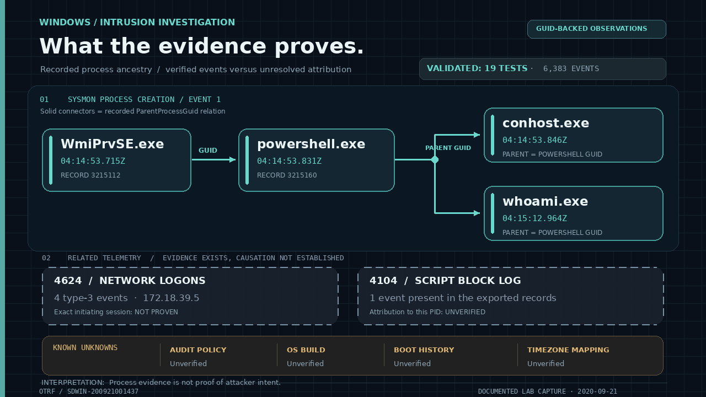

# Windows Intrusion Investigation: Evidence vs. Assumptions

**Reproducible Windows event-log investigation of a documented, authorised attack simulation.**  
Python analysis · Sysmon process ancestry · event correlation · 19 regression tests



[Watch the animated evidence walkthrough](https://studio.anim-g-studio.co.uk/g/windows-incident-investigation/visual/video_v2/) · [Read the full investigation](investigation.md) · [Dataset provenance](dataset_provenance.md)

## What I investigated

I examined **6,383 exported Windows event records** from the Open Threat Research Forge (OTRF) Mordor **Empire Invoke WMI** lab simulation (`SDWIN-200921001437`). Of these, **1,871** were attributable to the target host `WORKSTATION6` after documented short-name/FQDN normalisation.

The question was straightforward: **what can we actually establish from the recorded events, and what would be speculation?**

This is historical authorised lab telemetry, **not** evidence of a compromise of a live organisation. The source archive is exported JSON inside a ZIP, **not original EVTX**.

## Findings, without overclaiming

| Observation | What is supported | What is not established |
| --- | --- | --- |
| Sysmon Event 1 process records | `WmiPrvSE.exe` → `powershell.exe` → `whoami.exe`, using matching `ProcessGuid` / `ParentProcessGuid` fields | Identity and intent of the person operating the commands |
| Security Event 4624 | Four type-3 network-logon events were observed from `172.18.39.5` | Which session, if any, initiated the particular process chain |
| PowerShell Event 4104 | One script-block event **is present** in the export | That it belongs to the exact PowerShell process above |
| Security/PowerShell event times | Local `EventTime` values exist | Their verified conversion to UTC in the supplied export |
| Collection gaps | Selected events are present in this export | Full audit-policy history, OS build, reboot history or export completeness |

The process chain is supported by **recorded GUID references**, not just reused numeric PIDs. Sysmon `UtcTime` drives that timeline; other channels' local timestamps are not silently treated as UTC.

## Reproduce the analysis

Requires **Python 3** and the pinned dependency.

```bash
python -m pip install -r requirements.txt
python -m unittest -v test_analyze.py
python analyze.py samples/mordor_empire_wmi.zip --host WORKSTATION6 --output findings.md --json findings.json
```

The analyzer can also parse original Windows `.evtx` input files through `python-evtx`, but this example intentionally uses the **original OTRF ZIP export**.

**Expected result:** 19 passing tests and generated findings grouped into four confidence categories:

- **`confirmed`**: directly supported by identified records
- **`consistent_with`**: plausible interpretation with unresolved evidence
- **`unknown`**: evidence needed for a determination is unavailable or unverified
- **`unsupported`**: claims not justified by this dataset

The tool is a focused investigation aid, **not** a general-purpose intrusion detector, SIEM, or attribution engine. Tests cover GUID-linked process ancestry, PID-only downgrades, reboot-boundary checks, Sysmon Event 12 versus system boot markers, and PowerShell logging caveats.

## Repository map

| File | Purpose |
| --- | --- |
| [`analyze.py`](analyze.py) | Read-only event parser, process linking and confidence rules |
| [`test_analyze.py`](test_analyze.py) | 19 regression tests |
| [`findings.md`](findings.md) / [`findings.json`](findings.json) | Reproducible machine-generated results |
| [`investigation.md`](investigation.md) | Detailed narrative and UTC timeline |
| [`dataset_provenance.md`](dataset_provenance.md) | Original URL, pinned commit, SHA-256, event counts, caveats |
| [`samples/`](samples/) | Original upstream ZIP and scenario metadata |
| [`docs/evidence_timeline.png`](docs/evidence_timeline.png) | Visual reconstruction, illustrative not live SOC footage |
| [`test_output.txt`](test_output.txt) | Captured test run |
| [`archive/initial-eight-event-case/wmi_target.evtx`](archive/initial-eight-event-case/wmi_target.evtx) | Separate 8-event EVTX fixture, included solely to regression-test the native EVTX parser; **not** part of the OTRF investigation |

## Source integrity and attribution

**OTRF/Security-Datasets**, [pinned upstream commit `d9d40ef123d2c87d5d3df28c96bcab4f0faccc87`](https://github.com/OTRF/Security-Datasets/tree/d9d40ef123d2c87d5d3df28c96bcab4f0faccc87). The date of that repository commit is **not** the lab event date (21 September 2020).

- ZIP SHA-256: `96f1dbd9c5b077c8951b6e1f43b7fe01a2620c649889262481f15139a1746d88`
- Uncompressed source JSON SHA-256: `b796a97fac2b94e03cce777b88960d227c1ae5e4ce4824f2f1540b28ff3479f3`

The bundled upstream dataset is licensed under **MIT**, with its original copyright and licence notice preserved in [`third_party/OTRF_LICENSE.txt`](third_party/OTRF_LICENSE.txt). The original analysis code has no separate reuse licence declared in this release.

## How this was built

This is an **AI-assisted project**, with conclusions checked against the raw event records, documented provenance and a regression test suite. The important outcome is not an exciting attack narrative: it is a reconstruction that **distinguishes observation from attribution and uncertainty**.

> A convincing timeline is not proof of every assumption behind it.
